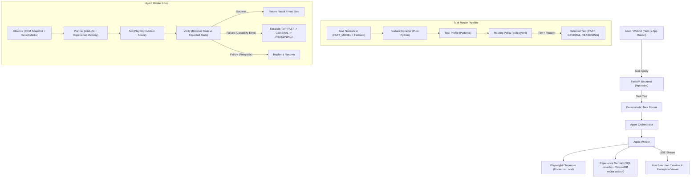

# WebMind: Failure-Aware Autonomous AI Web Agent

WebMind is a generic, failure-aware autonomous AI web agent with task-aware multi-agent orchestration, deterministic tier routing (Fast, General, Reasoning), an observe-plan-act-verify browser loop, and verification-driven capability escalation.

---

## Architecture Overview



---

## Key Features

1. **Deterministic Task Routing**: Rules and thresholds defined in `policy.yaml` route queries deterministically to `FAST`, `GENERAL`, or `REASONING` agents based on constraints, comparison needs, target site count, and expected steps. Every routing decision produces an interpretable audit reason.
2. **Generic Browser Loop**: No hardcoded scrapers. Uses an observe-plan-act-verify loop driven by Playwright with Set-of-Marks visual indexing and machine-verifiable expected browser states.
3. **Capability-Driven Escalation**: When verification detects reasoning errors, loops, or step budget exhaustion, WebMind automatically escalates `FAST -> GENERAL -> REASONING`, carrying over visited URLs, extracted data, and failed approaches.
4. **Human-in-the-Loop Safety**: Irreversible actions (purchases, payments) and sensitive fields (credit cards) are halted by automated safety guardrails and routed to an interactive user approval dialog (`ask_user`).
5. **Universal Provider Support**: Uses LiteLLM to seamlessly route to Gemini, OpenAI, or Anthropic models with a single API key.
6. **Experience Memory**: Verified failures, recoveries, and reusable workflows are stored with structured evidence in the configured SQL database. ChromaDB retrieves semantically similar memories for each observed step; a deterministic applicability gate then decides whether to pass them to the planner as suggestions. Every action is still verified against the live page.

---

## Persistent Experience Memory

WebMind stores canonical memory records, reliability feedback, and evidence history in the SQL database configured by `DATABASE_URL`. Embeddings and searchable memory documents are indexed in ChromaDB. On startup, WebMind idempotently backfills existing SQL memories into ChromaDB; newly recorded or recovered memories are upserted immediately. Docker Compose runs a persistent ChromaDB service on its own `chroma-data` volume. Local backend runs use `CHROMA_PERSIST_DIRECTORY` (default `./chroma_data`). Embeddings use the configured local SentenceTransformers model (`MEMORY_EMBEDDING_MODEL`); if it cannot load, the service uses a deterministic hash embedding. No embedding API key is required.

The worker observes the current DOM, retrieves up to `MEMORY_TOP_K` candidates, evaluates task/page/domain/action compatibility, and supplies only `USE` or `CAUTIOUS` entries to the planner. `CAUTIOUS` memories require fresh inspection. `IGNORE` memories remain in audit history but are excluded from planner context. Memory guidance cannot override current page state, user instructions, or action safety checks.

After each browser action, WebMind runs its existing verifier. A verified alternative after a failure is stored as a recovered experience. Verified multi-action workflows are stored at task completion when they have at least two actions. Reuse reliability changes only for a matching stored action whose outcome is attributable to the memory; unrelated network/API failures do not count against it. Reliability uses a Beta-Bernoulli posterior mean:

```text
(success_count + MEMORY_BETA_ALPHA) /
(success_count + failure_count + MEMORY_BETA_ALPHA + MEMORY_BETA_BETA)
```

Records are deduplicated by domain, page, failure/action, recovery, and workflow shape. Common email addresses, phone numbers, payment-card-like numbers, and secret tokens are redacted. Action input values are not stored. The **Experience Memory** tab shows actual records, evidence, retrieval/gate history, counts, and reliability; deletion and clear-all require explicit confirmation.

Memory settings (these defaults are active):

```env
MEMORY_ENABLED=true
MEMORY_TOP_K=5
MEMORY_CANDIDATE_LIMIT=500
MEMORY_SIMILARITY_THRESHOLD=0.22
MEMORY_USE_THRESHOLD=0.68
MEMORY_CAUTION_THRESHOLD=0.42
MEMORY_MIN_RELIABILITY=0.35
MEMORY_BETA_ALPHA=2.0
MEMORY_BETA_BETA=2.0
MEMORY_EMBEDDING_TIMEOUT_SECONDS=8.0
MEMORY_EMBEDDING_MODEL=all-MiniLM-L6-v2
CHROMA_PERSIST_DIRECTORY=./chroma_data
```

The deterministic gate score combines task similarity and task type (0.30), page similarity (0.22), website match (0.15), action compatibility (0.15), historical reliability (0.10), recency (0.05), and current failure-type compatibility (0.03), with a small bonus for verified recoveries. `USE` also requires the same normalized domain, page similarity of at least 0.45, reliability above the configured minimum, a recent-enough record, and a compatible current failure type when recovering. Cross-domain or incomplete matches can only be `CAUTIOUS`; task-similarity and minimum-reliability failures are `IGNORE`.

### Human browser handoff

When a task needs information, the UI prompts for a response. For sign-in and CAPTCHA/access checks, users can choose **Take over browser tab** to see the paused Playwright page, fill visible inputs, select observed dropdown options, click controls, and then resume the agent. Actions use fresh control observations; if the page changes, the panel refreshes and rejects stale control IDs. Field values are sent to the website but are not put into task traces or memory; sensitive input values are redacted from planner snapshots. Consequential controls remain protected by the existing approval prompt. The handoff APIs are available only while an active worker is waiting for the user.

---

## Getting Started

### 1. Prerequisites
- Docker & Docker Compose (or Python 3.11+ and Node.js 20+ for local development)
- An API key for your chosen LLM provider (Google Gemini, OpenAI, or Anthropic)

### 2. Configure Environment
Copy `.env.example` to `.env`:
```bash
cp .env.example .env
```
Set your `LLM_API_KEY` in `.env`:
```env
LLM_API_KEY="your-api-key-here"
LLM_PROVIDER="gemini"
FAST_MODEL="gemini/gemini-2.5-flash"
GENERAL_MODEL="gemini/gemini-2.5-flash"
REASONING_MODEL="gemini/gemini-2.5-pro"
VLM_MODEL="gemini/gemini-2.5-flash"
DATABASE_URL="postgresql+asyncpg://webmind:webmind@db:5432/webmind"
```

### 3. Run with Docker Compose
```bash
docker compose up --build
```
- Frontend UI: `http://localhost:3000`
- Backend API Docs: `http://localhost:8000/docs`

### 4. Running Locally without Docker
If running natively on the host:
```bash
# Backend
cd backend
python -m venv .venv
source .venv/bin/activate  # On Windows: .venv\Scripts\activate
pip install -r requirements.txt
playwright install chromium
uvicorn app.main:app --host 0.0.0.0 --port 8000

# Frontend
cd frontend
npm install
npm run dev
```

Run backend tests from `backend` with `python -m pytest tests -q`. The memory tests use temporary SQLite databases and deterministic embeddings, without paid model calls or live third-party websites.

---

## Tuning Routing Policy (`policy.yaml`)

Routing rules are defined declaratively in `backend/app/router/policy.yaml`:
```yaml
thresholds:
  reasoning:
    min_constraints: 3
    require_comparison: true
    require_multi_site: true
    require_decision: true
    task_types:
      - comparison
      - multi_site
    reasoning_requirement: high

  general:
    min_constraints: 1
    require_filtering: true
    require_form_fill: true
    require_extraction: true
    task_types:
      - form_fill
      - filtering
      - extraction
      - navigation
    expected_steps:
      - medium

  fast:
    fallback_tier: FAST
```
- To make WebMind use the `REASONING` tier on queries with fewer constraints, lower `min_constraints` to `2`.
- Every routing decision records the exact triggers that activated the tier in the database and streams them to the UI.

---

## Evaluation Benchmark Harness

WebMind includes a 20-task benchmark suite testing:
- **Config A**: Fixed Fast Agent (no escalation)
- **Config B**: Fixed Reasoning Agent (no escalation)
- **Config C**: WebMind Task-Aware Adaptive Routing (with escalation)

To run the evaluation:
```bash
python -m app.eval.run_eval --config all --mock
```
Output results are exported to `app/eval/eval_results.csv` and rendered on the **Metrics & Eval** dashboard.

---

## Limitations & Safety Guardrails
- **CAPTCHA & Login Walls**: WebMind does not solve or bypass these checks; it pauses, asks the user to take over the browser tab, and resumes after the user finishes.
- **Financial Transactions**: All purchase/payment buttons trigger an `ask_user` human approval prompt.
- **Credit Card Data**: The action executor prohibits entering 13-16 digit numbers matching card patterns.
